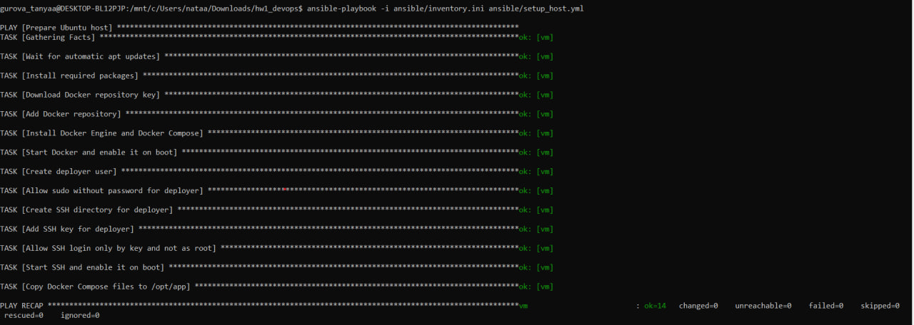
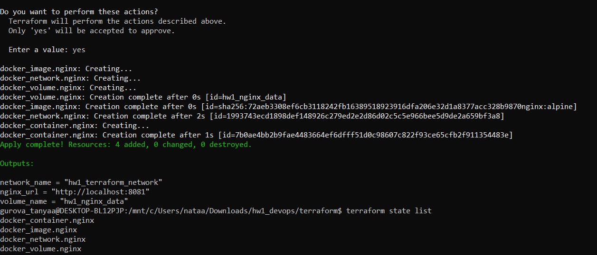
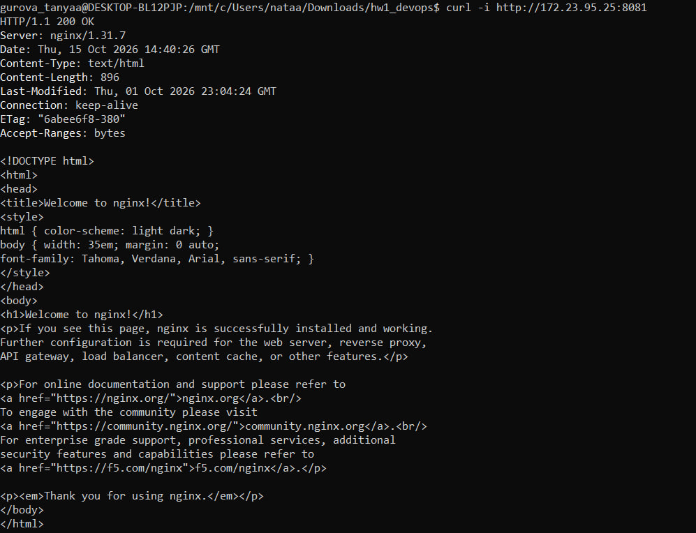
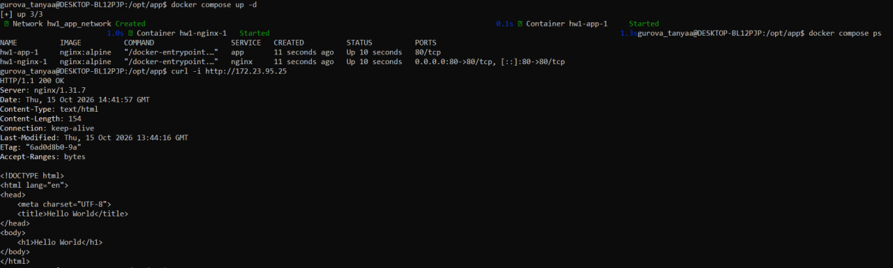
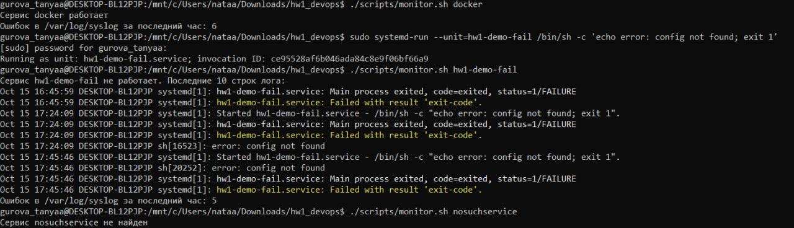
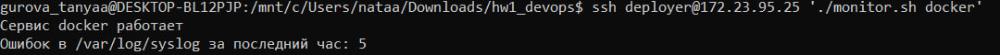

# ДЗ 1. Фундамент DevOps-инфраструктуры

Вместо облачной VM используется Ubuntu 24.04 в WSL2 на Windows 10. У неё свой IP `172.23.95.25`, systemd и вход по SSH. Порядок выполнения — как в дополнении к заданию: сначала Ansible, потом Terraform с провайдером Docker, потом Docker Compose и скрипт мониторинга.

## Структура

```text
ansible/     setup_host.yml, inventory.ini (VM по IP), inventory_local.ini (первый запуск)
terraform/   main.tf, variables.tf, outputs.tf, mirror.tfrc
compose/     docker-compose.yml, nginx.conf, html/index.html
scripts/     monitor.sh
screenshots/ скриншоты результатов
```

| Что | Контейнеры | Сеть | Порт |
| --- | --- | --- | --- |
| Terraform | `hw1_terraform_nginx` + том `hw1_nginx_data` | `hw1_terraform_network` | 8081 |
| Docker Compose | `nginx` (reverse proxy) → `app` (Hello World) | `hw1_app_network` | 80 |

## Подготовка (один раз)

Команды выполняются в терминале Ubuntu (WSL). Нужен включённый systemd: `[boot]` и `systemd=true` в `/etc/wsl.conf`.

```bash
sudo apt update
sudo apt install -y ansible-core unzip
curl -Lo /tmp/terraform.zip https://hashicorp-releases.yandexcloud.net/terraform/1.13.5/terraform_1.13.5_linux_amd64.zip
sudo unzip /tmp/terraform.zip terraform -d /usr/local/bin
cd /mnt/c/Users/nataa/Downloads/hw1_devops
cp terraform/mirror.tfrc ~/.terraformrc
ls ~/.ssh/id_rsa.pub || ssh-keygen -t rsa -N '' -f ~/.ssh/id_rsa
hostname -I
```

- Terraform скачивается с зеркала Yandex: сайт HashiCorp из России отвечает 404. По той же причине `mirror.tfrc` подключает зеркало провайдеров.
- `hostname -I` показывает IP Ubuntu. После перезапуска WSL он может поменяться — тогда новый адрес нужно вписать в `ansible/inventory.ini`.

Первый запуск playbook выполняется локально. Пока нет пользователя deployer и SSH-сервера, подключиться по IP нельзя. `-K` спросит пароль sudo:

```bash
ansible-playbook -i ansible/inventory_local.ini -K ansible/setup_host.yml
sudo usermod -aG docker $USER
ssh deployer@172.23.95.25 hostname
```

`usermod` добавляет вашего пользователя в группу docker, чтобы Terraform и `docker compose` работали без sudo. Изменение действует в новом окне терминала. При первом `ssh` нужно ответить `yes`.

## 1. Ansible

`ansible/setup_host.yml`:

- устанавливает Docker Engine и Docker Compose, включает автозапуск Docker;
- создаёт пользователя `deployer`: sudo без пароля, группа docker, вход только по SSH-ключу;
- запрещает вход по SSH с паролем и под root;
- копирует файлы из `compose/` в `/opt/app`.

Дальше playbook запускается по SSH через `inventory.ini`, где указан IP VM. Для проверки идемпотентности запускается два раза; во второй раз должно быть `changed=0`:

```bash
ansible-playbook -i ansible/inventory.ini ansible/setup_host.yml
ansible-playbook -i ansible/inventory.ini ansible/setup_host.yml
```



## 2. Terraform

`terraform/main.tf` создаёт новую сеть, том, образ и контейнер nginx. Контейнер работает только в этой сети, том подключён к `/usr/share/nginx/html`, порт 80 опубликован на нестандартном порту 8081. Порт и адрес Docker вынесены в `variables.tf`.

```bash
cd terraform
terraform init
terraform plan
terraform apply
terraform state list
curl -i http://172.23.95.25:8081
cd ..
```





State хранится в `terraform/terraform.tfstate` и в Git не попадает. По нему Terraform знает, какие объекты он создал.

## 3. Docker Compose

В `/opt/app` два сервиса в общей сети `hw1_app_network`. `nginx` принимает запросы на порту 80 и передаёт их в `app` по имени сервиса. `app` отдаёт страницу Hello World и наружу порт не открывает.

```bash
cd /opt/app
docker compose up -d
docker compose ps
curl -i http://172.23.95.25
cd /mnt/c/Users/nataa/Downloads/hw1_devops
```



## 4. Мониторинг

`scripts/monitor.sh <сервис>`:

1. проверяет сервис через `systemctl is-active`;
2. если сервис не работает, показывает 10 последних строк `journalctl`;
3. считает строки с error в `/var/log/syslog` за последний час (`grep` + `awk`).

Если сервис не найден или syslog недоступен, скрипт сообщает об этом и завершается с кодом 1.

Локальная машина. `hw1-demo-fail` — специально созданный сервис, который сразу падает:

```bash
./scripts/monitor.sh docker
sudo systemd-run --unit=hw1-demo-fail /bin/sh -c 'echo error: config not found; exit 1'
./scripts/monitor.sh hw1-demo-fail
./scripts/monitor.sh nosuchservice
```



Число ошибок считается за скользящий последний час. Поэтому оно может уменьшиться, даже если появились новые ошибки: строки старше часа перестают учитываться.

Удалённая VM, по SSH под deployer:

```bash
scp scripts/monitor.sh deployer@172.23.95.25:~
ssh deployer@172.23.95.25 './monitor.sh docker'
```



## Архитектурные решения

- **Docker вместо облака.** По дополнению к заданию Terraform использует провайдер `kreuzwerker/docker`. Облачных VPC, Security Group и IAM здесь нет. Окружения разделены сетями Docker, наружу открыты только нужные порты, для работы создан отдельный пользователь deployer.
- **WSL как VM.** Ubuntu в WSL2 — полноценный Linux с systemd и своим IP. Этот IP доступен только с этого компьютера.
- **Порты.** Compose-прокси слушает 80, чтобы работал `curl http://<VM_IP>`. Terraform-nginx использует нестандартный порт 8081. `app` наружу не публикуется.
- **Доступ.** SSH только по ключу, вход по паролю и под root запрещён. Terraform и Docker Compose запускаются без root. deployer получил sudo без пароля по условию задания.
